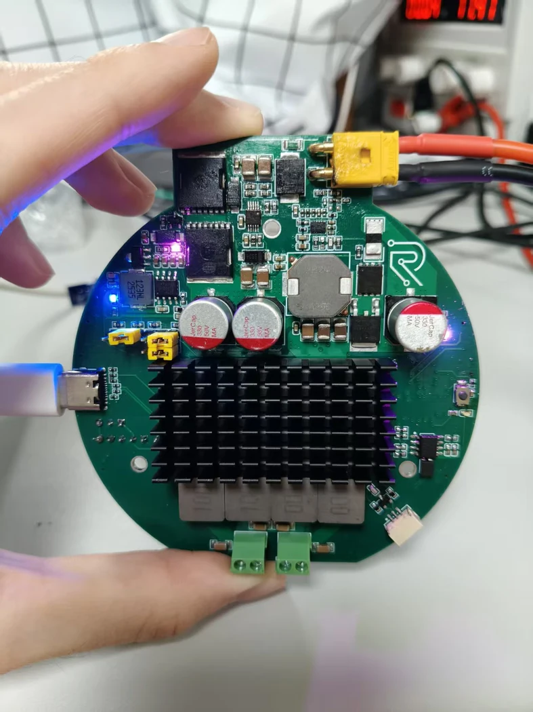
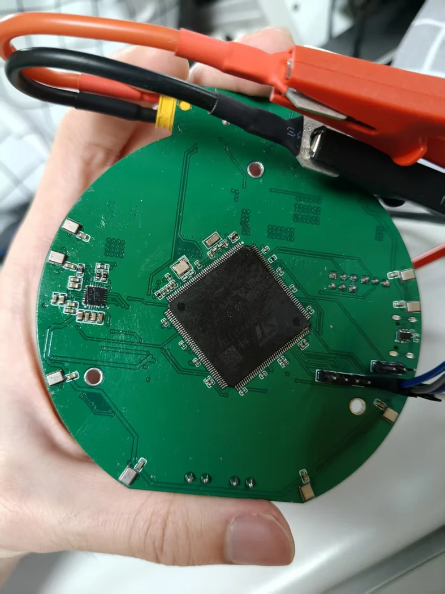
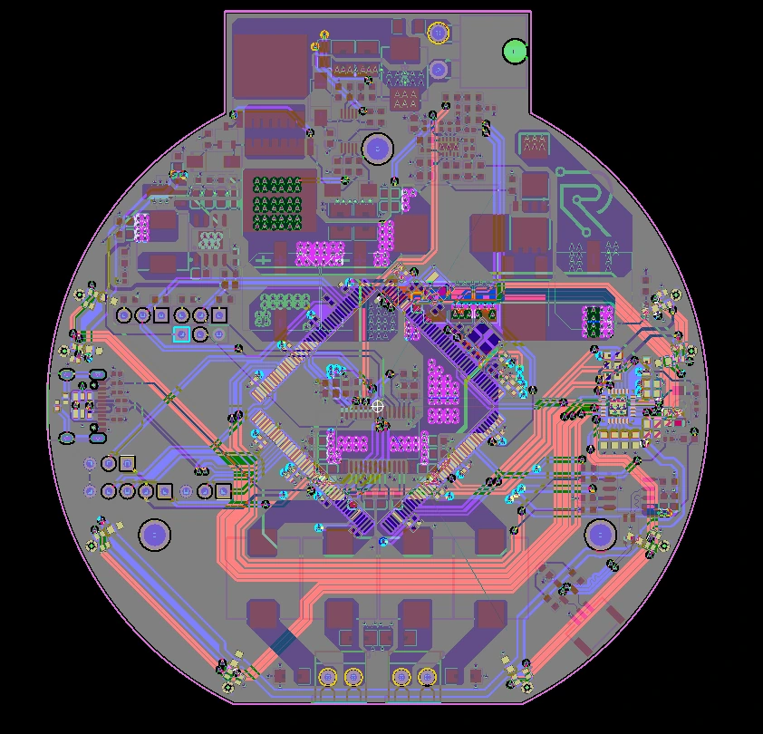

# 八通道人形机器人音频子系统

我为人形机器人的语音交互做了一块六层音频板，把八路麦克风拾音、USB 音频接入和扬声器播放放在同一块板上。我负责器件选型、原理图和 PCB 布局布线。

正面是功放、散热片和电源接口，背面可以看到 STM32H743 主控。点照片可看大图。

**[下载嘉立创 EDA 专业版工程](hardware/eda/Robot-Audio.epro2?raw=true)** · [浏览硬件文件](hardware/)

## 硬件设计

- **八路拾音。** 8 颗 PDM 数字 MEMS 麦克风接到 PCMD3180，由它输出 TDM，再送入 STM32H743。阵列布局时同时处理 PDM 时钟、数据线和各路供电去耦。
- **音频播放与接口。** STM32H743 接入 USB 音频，通过 I²S 把数据送到 TAS5828M 双声道数字功放。功放经 LC 滤波，以 BTL 方式驱动 4 Ω 扬声器。板上另有 CAN 接口。
- **Class-H 供电。** 音频包络对应的 PWM 经 RC 滤波送入 LM5125A-Q1 的 ATRK 引脚，由双相交错同步 Boost 调整功放电源电压。输入侧用 LM5060、MOSFET、TVS 和保险丝做受控上电与过压保护。
- **六层 PCB。** 麦克风阵列、主控、Boost 和功放分区布局。布线重点是缩短 Boost 高频换流和栅极回路、电流采样使用 Kelvin 取样，以及给功放 BTL 输出和去耦留出合适的回流路径。

## PCB 布局

## 工程文件

[Robot-Audio.epro2](hardware/eda/Robot-Audio.epro2) 包含可编辑的原理图和 PCB。下载后在嘉立创 EDA 专业版中导入。固件源码暂未上传。
